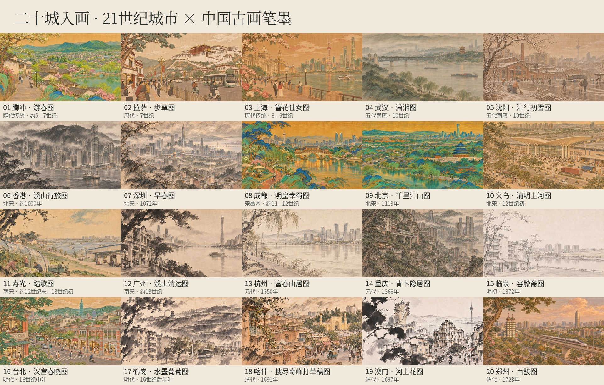

# 二十城入画

**以二十幅不同中国古画的笔墨语言，描绘二十一世纪的二十座城市。**

全片约 **2分17秒**，1920×1080、24fps，含普通话男声解说、同步中文字幕、逐段城市/画作/时代角标和MP4章节。

[观看及下载完整视频（1080p）](https://github.com/wanglu2016/ershi-cheng-ruhua/releases/download/v1.0.0/city-in-ancient-ink-1080p.mp4) · [视频发布页](https://github.com/wanglu2016/ershi-cheng-ruhua/releases/tag/v1.0.0) · [中文字幕](city-in-ancient-ink.srt)

## 创作方法

镜头的主体始终是今天的城市：高楼、公交车、高铁、港口、市场、住宅、骑楼、设施农业与现代行人。每座城市对应一幅不同古画，借鉴其笔墨、设色、构图、肌理与空间组织。古画的题材故事和原有构图不直接搬进城市。

20幅新创城市风格画面，经连续虚拟运镜、叠化转场、轻雾与落雪动态合成为一部动态绘画短片。画面是艺术化的城市意象组合，各地标并非同一真实机位下的测绘关系。传统建筑作为今天仍存在的城市景观入画。声音使用 `zh-CN-YunxiNeural` 普通话男声，原速，并依实际语音时间戳对齐字幕。

## 为什么选这二十座城市

名单关注城市经验的互补性，覆盖沿海、内陆、东部、中部、西部、东北与港澳台地区，同时保留超大城市、资源城市、区域中心和县域生活。

五个县级行政单元为义乌、寿光、腾冲、喀什市和临泉县。临泉以县城景观纳入；“县级”是行政层级，不能用来推断人口或经济规模。这里没有给城市划分所谓正式的“八线”等级。

## 画作时间线、城市选择与表现方法

时间为成片中该段开始的位置；画作名称均不重复。角标呈现的就是相应作品和时代。

| 开始 | 城市及选择理由 | 对应古画与时代 | 用于今日城市的视觉语言 |
|---|---|---|---|
| 00:07 | **腾冲**：滇西县级市，呈现山地、侨乡、旅游与旅居生活。 | 《游春图》 · 传展子虔；隋代传统 · 约6—7世纪 | 青绿薄染、细劲轮廓与早期山水的开阔空间，表现低矮屋顶、现代住宅和山林。 |
| 00:14 | **拉萨**：高原区域中心，传统建筑与现代公共交通同在。 | 《步辇图》 · 传阎立本；唐代 · 7世纪 | 把铁线描、朱红石绿和平面设色用于当代街道、公交车与布达拉宫的组合。 |
| 00:20 | **上海**：沿海超大都市，金融、航运与日常消费生活高度交织。 | 《簪花仕女图》 · 传周昉；唐代传统 · 8—9世纪 | 取工笔细线、重彩和绢色肌理，描绘今日外滩行人及浦东天际线。 |
| 00:26 | **武汉**：中部江湖都市，桥梁把制造、教育与居民生活连接起来。 | 《潇湘图》 · 传董源；五代南唐 · 10世纪 | 用低平横展、柔和皴点和湿润烟水，组织现代长江大桥与两岸楼群。 |
| 00:32 | **沈阳**：东北工业城市，工厂、工人社区与新产业共同构成当下。 | 《江行初雪图》 · 赵干；五代南唐 · 10世纪 | 取淡墨绢色、细密寒林和粉雪效果，描绘仍有人工作生活的铁西街区。 |
| 00:38 | **香港**：国际金融与专业服务城市，也是一座山海之间的高密度城市。 | 《溪山行旅图》 · 范宽；北宋 · 约1000年 | 以巨碑式层次和雨点皴的厚重感组织高楼，让楼群成为城市自己的群峰。 |
| 00:44 | **深圳**：改革开放、移民城市、制造与技术创新的交汇。 | 《早春图》 · 郭熙；北宋 · 1072年 | 取云气与疏密交替的空间处理，让现代楼宇、道路与城中村在雾中显现。 |
| 00:50 | **成都**：西部大城市，区域就业中心与公园、绿道生活彼此叠加。 | 《明皇幸蜀图》 · 佚名（旧传李昭道）；宋摹本 · 约11—12世纪 | 借唐式青绿传统的细线与矿物色，画平原城市的桥、楼群和骑行绿道。 |
| 00:56 | **北京**：国家公共机构、知识生产与历史空间高度集聚的首都。 | 《千里江山图》 · 王希孟；北宋 · 1113年 | 将浓丽石青石绿和长卷视点用于中轴地标、胡同、道路与当代CBD。 |
| 01:02 | **义乌**：浙江县级市，以专业市场和物流直接连接全球贸易。 | 《清明上河图》 · 张择端；北宋 · 12世纪初 | 取长卷俯瞰、细密界画和群体活动，描绘现代市场大厅、货车与商贸人流。 |
| 01:08 | **寿光**：山东县级市，以设施农业、种植、分拣和运输补上城市食物的来源。 | 《踏歌图》 · 马远；南宋 · 约12世纪末—13世纪初 | 借边角重心、斧劈式强线与淡色，把大棚、蔬菜、货车画进平坦田野。 |
| 01:14 | **广州**：岭南沿海商贸城市，专业市场、制造、外来人口与老城生活交叠。 | 《溪山清远图》 · 夏圭；南宋 · 约13世纪 | 用浓淡突变与大片江面留白，表现骑楼、珠江和广州塔。 |
| 01:20 | **杭州**：东部省会，数字经济与江南山水、都市生活相接。 | 《富春山居图》 · 黄公望；元代 · 1350年 | 以干笔披麻、淡赭和松弛横卷节奏，表现钱塘江、滨江绿道与现代楼宇。 |
| 01:27 | **重庆**：西部直辖市，山地交通、制造业和广阔城乡联系共同塑形。 | 《青卞隐居图》 · 王蒙；元代 · 1366年 | 把繁密、纵深、纠结的皴线转化为住宅、坡道、轨道和层层城市肌理。 |
| 01:33 | **临泉**：皖北县城，呈现务工、返乡、置业与家庭生活跨城安排的经验。 | 《容膝斋图》 · 倪瓒；明初 · 1372年 | 用惜墨、枯笔、水平分层和疏朗留白，描绘普通住宅、电动车、街铺与麦田。 |
| 01:39 | **台北**：台湾地区都市，以盆地中的街区密度、骑楼与现代服务生活补充另一种经验。 | 《汉宫春晓图》 · 仇英；明代 · 16世纪中叶 | 取精细界画、青绿重彩与近距离街区层次，描绘台北101、骑楼和机车。 |
| 01:45 | **鹤岗**：东北资源城市，矿业形成的空间与转型中的日常生活并存。 | 《水墨葡萄图》 · 徐渭；明代 · 16世纪后半叶 | 取草书式飞动线条、湿墨团块与大写意力度，画矿坑台阶、住宅及公交车。 |
| 01:51 | **喀什**：新疆县级市、南疆城市中心，绿洲街巷与向西商贸通道交汇。 | 《搜尽奇峰打草稿图》 · 石涛；清代 · 1691年 | 借自由变换的皴擦点染与穿行线索，描绘当代古城街区、商店和配送车辆。 |
| 01:57 | **澳门**：澳门特别行政区，旅游服务、旧城空间与现代高层形成紧密的城市叠置。 | 《河上花图》 · 八大山人（朱耷）；清代 · 1697年 | 把圆转长线、浓墨团块与大幅留白用于新葡京、大三巴与今日街道。 |
| 02:04 | **郑州**：中部人口大省的省会，以铁路、航空、物流与制造连接腹地和外部市场。 | 《百骏图》 · 郎世宁；清代 · 1728年 | 借中西融合的明暗塑造、透视纵深及细笔设色，让高铁与城市向远方延伸。 |

## 年代与归属说明

- 整体沿隋代传统、唐、五代、宋、元、明、清推进。有明确纪年的作品按纪年编排；只知大致年代且区间重叠的作品，以时代组衔接，不把估年当成精确先后。
- 《游春图》《簪花仕女图》等沿用传统归属，并在角标中保留“传”或“传统”；具体作者和断代存在学术讨论。
- 《明皇幸蜀图》保留唐式青绿传统，但现存本通常被视为约11—12世纪的宋人摹本。因此本片把它放入宋代组，角标明确写“宋摹本”，不将它直接标作唐代真迹。其区间与相邻北宋作品重叠，无法给出精确年序。
- 倪瓒虽然通常归入“元四家”，《容膝斋图》本身作于洪武壬子（1372），本片据作品时间标为“明初”。
- 风格与城市的对应是本片的创作选择，不能据此推断古画原来画的就是该城市。

## 古画参考来源

作品名称、归属、时代与视觉特征主要参考以下博物馆资料。链接提供原作信息；本片使用的是新创城市画面。

1. [传展子虔《游春图》](https://www.dpm.org.cn/collection/paint/234623.html)
2. [传阎立本《步辇图》](https://www.dpm.org.cn/collection/paint/234620.html)
3. [传周昉《簪花仕女图》](https://www.neac.gov.cn/seac/xwzx/202606/1191211.shtml)
4. [传董源《潇湘图》](https://www.dpm.org.cn/collection/paint/234585.html)
5. [赵干《江行初雪图》](https://digitalarchive.npm.gov.tw/Collection/Detail/51?dep=P)
6. [范宽《溪山行旅图》](https://theme.npm.edu.tw/selection/Article.aspx?sNo=04000959)
7. [郭熙《早春图》](https://digitalarchive.npm.gov.tw/Collection/Detail/47?dep=P)
8. [佚名（旧传李昭道）《明皇幸蜀图》](https://digitalarchive.npm.gov.tw/Collection/Detail/28?dep=P)
9. [王希孟《千里江山图》](https://www.dpm.org.cn/collection/paint/228354.html)
10. [张择端《清明上河图》](https://www.dpm.org.cn/collection/paint/228226.html)
11. [马远《踏歌图》](https://www.dpm.org.cn/collection/paint/234559.html)
12. [夏圭《溪山清远图》](https://theme.npm.edu.tw/selection/Article.aspx?sNo=04000965)
13. [黄公望《富春山居图》](https://theme.npm.edu.tw/selection/Article.aspx?sNo=04000975)
14. [王蒙《青卞隐居图》](https://www.shanghaimuseum.net/mu/frontend/pg/article/id/P00002811)
15. [倪瓒《容膝斋图》](https://theme.npm.edu.tw/selection/Article.aspx?sNo=04000992)
16. [仇英《汉宫春晓图》](https://theme.npm.edu.tw/selection/Article.aspx?sNo=04000980)
17. [徐渭《水墨葡萄图》](https://www.dpm.org.cn/collection/paint/231318.html)
18. [石涛《搜尽奇峰打草稿图》](https://www.dpm.org.cn/collection/paint/234551.html)
19. [八大山人（朱耷）《河上花图》](https://www.tjbwg.cn/cn/collectionInfo.aspx?Id=2616)
20. [郎世宁《百骏图》](https://theme.npm.edu.tw/selection/article.aspx?sno=04000989)

## 文件与核验

- `city-in-ancient-ink-1080p.mp4`：完整视频，保存在本仓库 Release `v1.0.0`。
- `poster.jpg`：20座城市和20种画风的总览。
- `city-in-ancient-ink.srt`：与配音对齐的中文字幕。
- `README.md`：本说明，包含城市选择、艺术处理、年代说明与来源。
- `verification.json`：音视频技术检查记录。

主视频 SHA-256：`35d3d861bff5badeae9fe4fbddda0de154e0ff473f8cde9ae4850634cafb4560`

作品包含20个城市段、片头和片尾。技术检查覆盖音视频编码、时长、完整解码、字幕时间范围与文件校验值；视觉检查覆盖各城画面和角标。技术检测不等于逐段人工听审。
